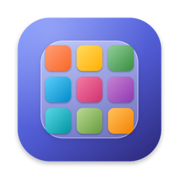
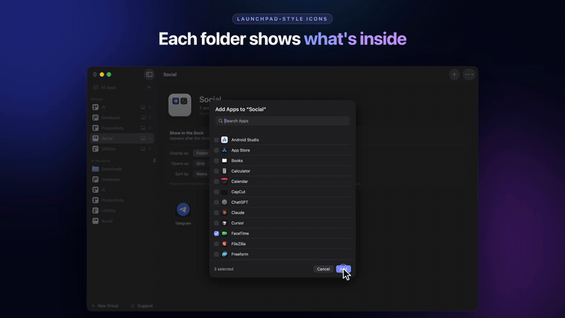
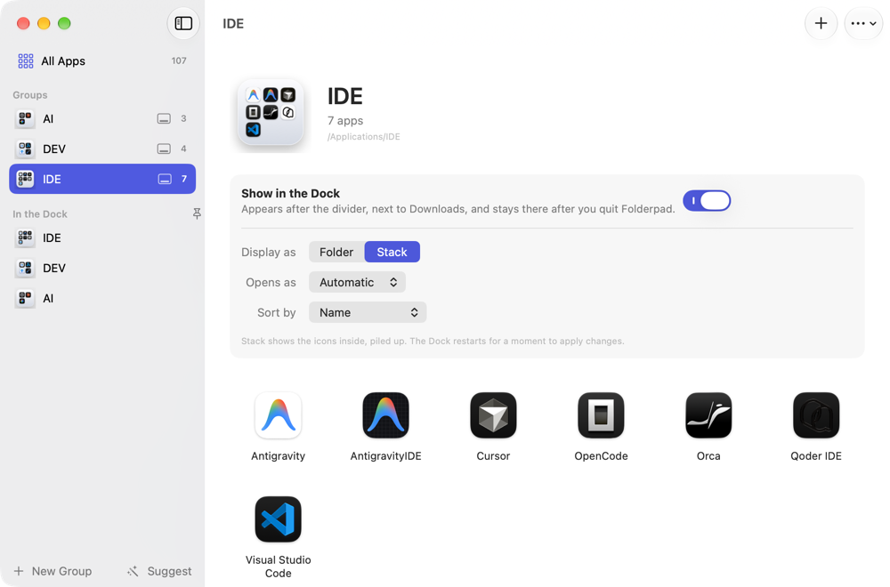
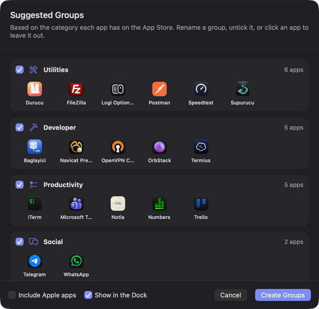

<p align="center">
  
</p>

<h1 align="center">Folderpad</h1>

<p align="center">
  <strong>App folders for macOS 26 and later, now that Launchpad is gone.</strong><br>
  Gather apps into groups and keep each group in the Dock as a folder that looks like a Launchpad folder.
</p>

<p align="center">
  <a href="https://skillhane.vercel.app/video/macos-26-launchpad-klasorleri-geri-getirme">Watch the short video and read the walkthrough (Turkish) on SkillHane</a>
</p>

<p align="center">
  
</p>

---

## Why

macOS 26 replaced Launchpad with the Apps view, which has no folders. Folderpad brings them back
using two things the Mac has always had:

- **A group is a folder of Finder aliases**, for example `/Applications/IDE` holding aliases to
  Cursor, Visual Studio Code and Xcode. The apps themselves never move.
- **The folder sits in the Dock**, after the divider. Click it to open the group as a grid,
  fan or list, just like a Dock stack.

Folderpad only builds and edits these. Quit it, or delete it, and the groups and Dock folders
stay exactly where they are. Open it again whenever you want to change or remove something.

## Features

- **Groups**: create, rename and delete groups; add apps from a searchable list, by dragging them
  from Finder, or from **All Apps**; remove an app with the minus button.
- **Folders you already made**: any folder in Applications that holds only app aliases is picked
  up as a group, so groups built by hand in Finder work straight away.
- **Launchpad-style icons**: each group folder gets an icon showing the apps inside (2×2 or 3×3).
  Shown as **Folder** in the Dock, that icon is what you see.
- **Everything in the Dock**: the **In the Dock** list shows every folder, file and link after the
  Dock's divider, including Downloads. Remove any of them, drag to reorder them, change how a
  folder is displayed (Folder or Stack; Grid, Fan, List or Automatic; sort order), or pin another
  folder with **Pin Folder to Dock…** (⇧⌘D).
- **Suggested groups**: one click proposes groups from each app's App Store category (Developer,
  Productivity, Creative, Social, Games, AI and more). Rename, untick or leave apps out before
  anything is created.
- Missing apps are flagged when an alias points at something that was uninstalled.

<p align="center">
  
  &nbsp;
  
</p>

## How it works

| What | Where |
| --- | --- |
| Group folders | `/Applications/<Group>`; or `~/Applications/<Group>` for accounts that are not administrators (Settings) |
| Group contents | Finder alias files named like the app, for example `Cursor.app` |
| Group icon | The folder's custom icon, set the same way as **Get Info › paste icon** |
| Dock folders | `persistent-others` in `com.apple.dock`; the Dock restarts briefly to apply a change |
| Groups Folderpad created | Tagged with the extended attribute `com.falconsw.folderpad.group`, so an empty group is still found |

Folderpad never deletes an app. Removing an app from a group deletes only its alias, and deleting
a group moves the folder to the Trash after checking that it holds nothing but app aliases.

## Install

Requires macOS 26 or later.

### Homebrew

```sh
brew install --cask falconsw/tap/folderpad
```

Update with `brew upgrade --cask folderpad`. Removing Folderpad (`brew uninstall --cask folderpad`)
leaves your groups and Dock folders in place.

### Direct download

Download the latest `.dmg` from [Releases](https://github.com/falconsw/folderpad/releases/latest)
and drag **Folderpad** into Applications. Builds are signed with a Developer ID and notarized by Apple.

## Building from source

Requires Xcode 26+ and [XcodeGen](https://github.com/yonaskolb/XcodeGen).

```sh
xcodegen generate          # generates Folderpad.xcodeproj from project.yml
open Folderpad.xcodeproj
./scripts/install.sh       # Release build installed to /Applications/Folderpad.app
./scripts/release.sh       # Developer ID signed, notarized DMG in dist/
```

Tests (Swift Testing) run against temporary folders and in-memory Dock tiles, never your real
Applications folder or Dock:

```sh
xcodebuild -project Folderpad.xcodeproj -scheme Folderpad -destination 'platform=macOS' test
```

The app icon is drawn by `scripts/make-icon.swift`:
`swift scripts/make-icon.swift Folderpad/Resources/Assets.xcassets/AppIcon.appiconset`

## Project layout

| Folder | Contents |
| --- | --- |
| `Folderpad/Engine` | Group folders and aliases (`GroupStore`), app discovery, Dock tiles, folder icons, suggestions |
| `Folderpad/Models` | `Library`, the observable model behind every view |
| `Folderpad/Views` | Sidebar, All Apps, group and Dock item pages, sheets, settings |
| `Folderpad/App` | App entry point and debug window snapshots |

## License

MIT © Ömer Faruk Dogan, Falcon Software
